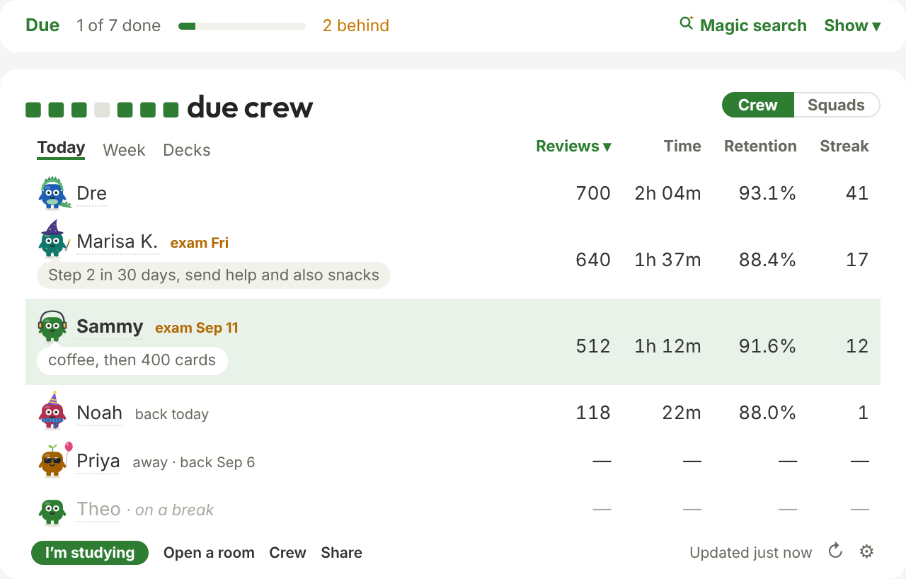
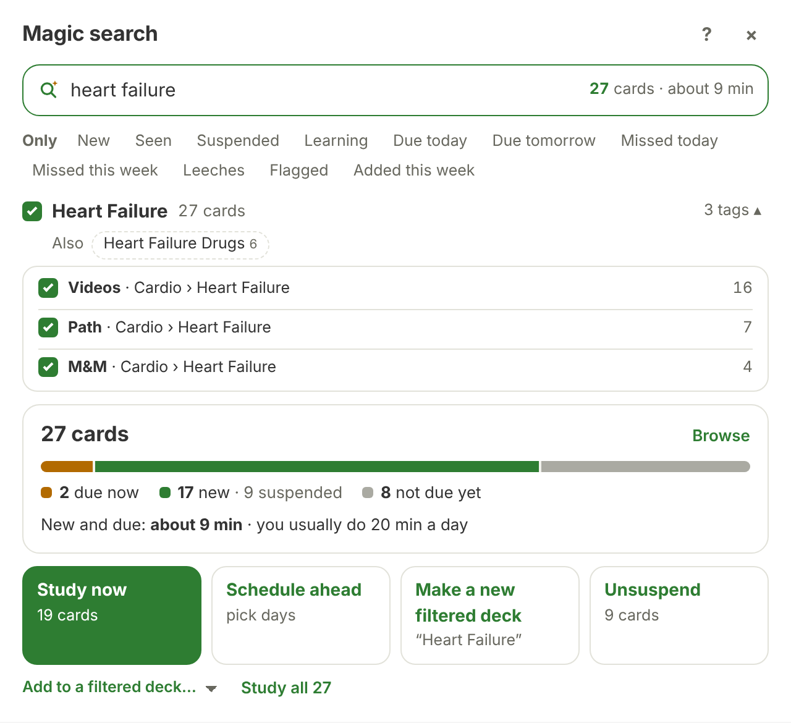
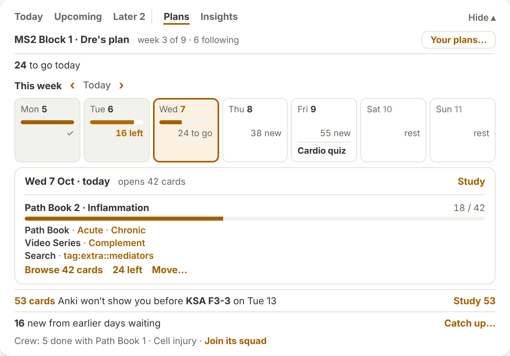
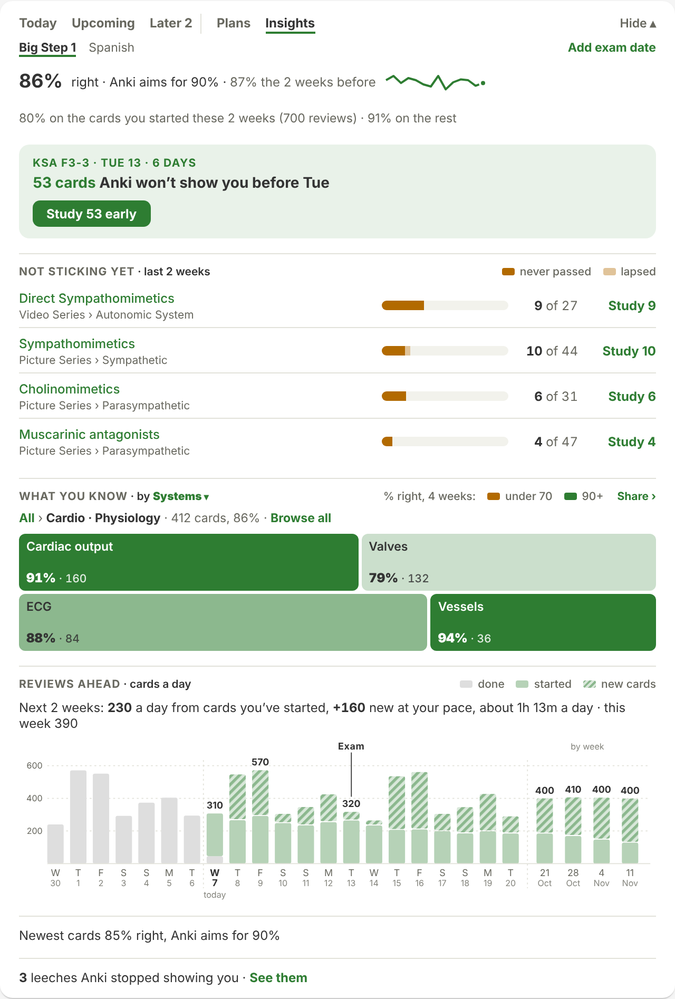
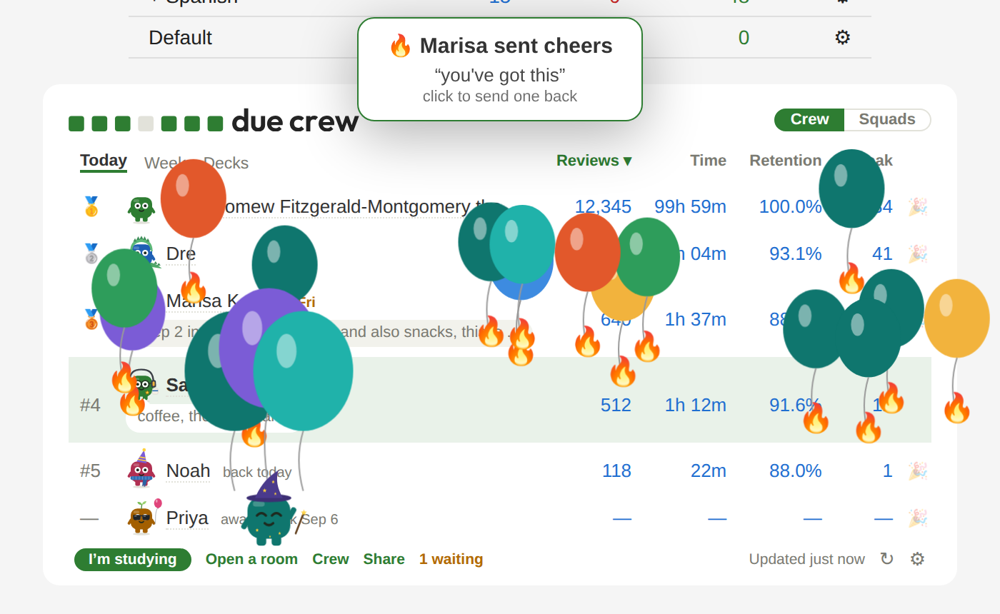
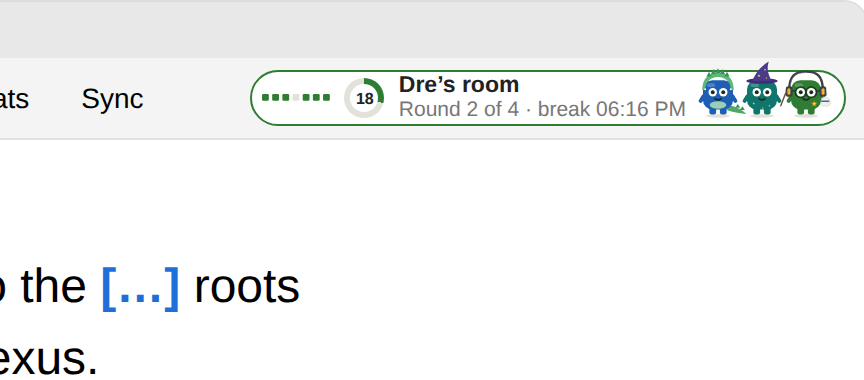
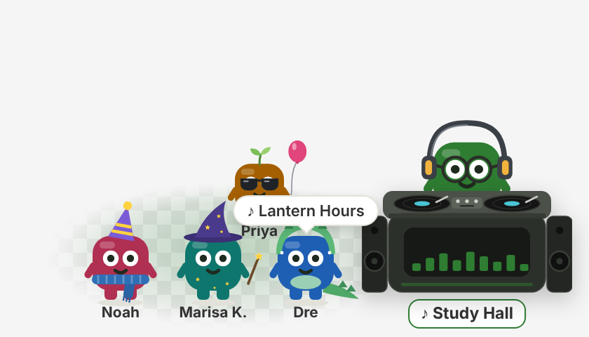
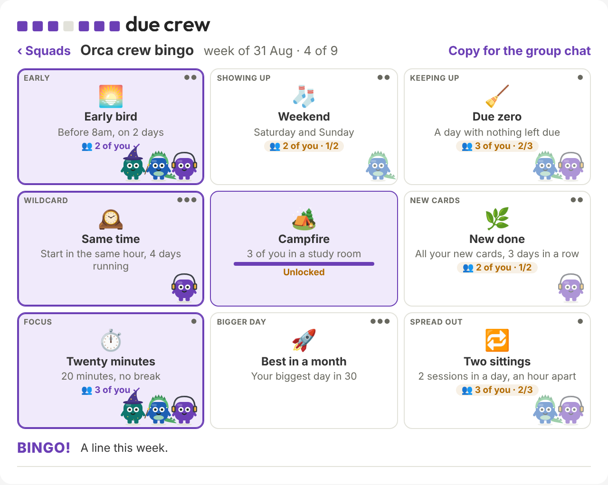
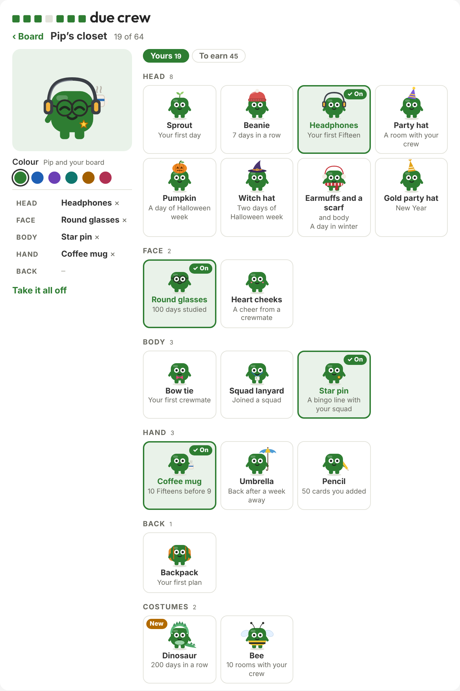
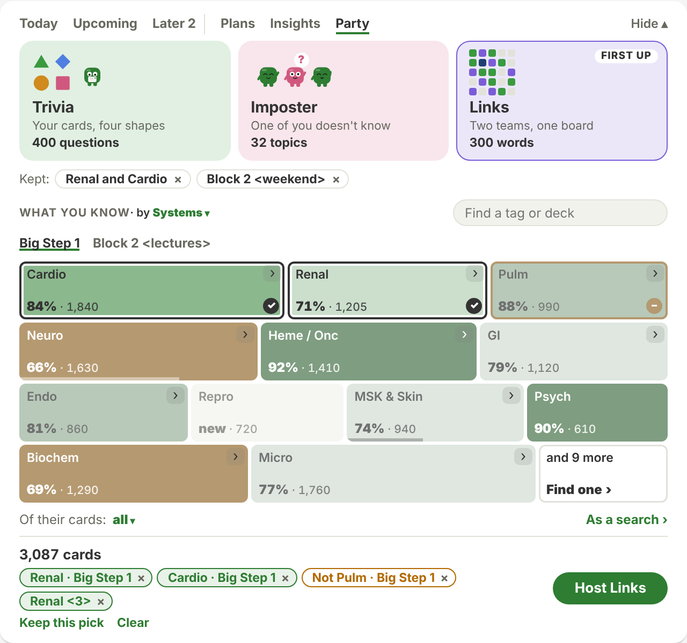

<picture>
  <source media="(prefers-color-scheme: dark)" srcset="docs/logo/svg/due-crew-logo-dark.svg">
  
</picture>

Your friends' studying next to yours, on Anki's Decks screen.

Studying for a big exam is more fun with friends! Due Crew is an Anki
add-on. It shows your friends under your deck list: who studied today,
who's studying now, and how much.

You only see people you've added, and they only see you if they add you
back. Your cards never leave your computer.

## Get started

1. In Anki: Tools → Add-ons → Get Add-ons. The code is **2035408484**.
   Restart Anki. (Needs Anki 2.1.55 or newer.)
2. Click **Start with your email** on the Decks screen. We email you a
   code. No password.
3. Paste a friend's invite, or a class, squad or plan code. Or send
   your invite to a friend.

## Magic search

Type what you want to study: "heart failure", "due this week", "30
minutes of renal". You can paste question IDs from a practice block
too. It finds the cards. Then you can study them now, put them on a
day, make a filtered deck, or unsuspend them.

## Study plans

A plan is a study calendar for a class or a group of friends. Pick
chapters from a deck, set the pace, add the exam date, and share the
code. Everyone who follows it gets that day's cards each morning.

Make one in Anki (Tools → Due Crew → Plans → New plan…) or at
duecrew.com.

- **If you fall behind,** the plan waits for you. Study the days you
  missed or skip them.
- **Go at your own pace** if you'd rather not follow the calendar.
- **Cram before class or a quiz:** one click puts those cards in a
  deck.
- **If you write the plan,** you can add co-authors, leave notes for
  followers, and tag their cards by lecture.

## Your day

Above your friends is your own day.

- **Today:** what's due, what your plan opens, and your to-dos.
- **Upcoming:** the next two weeks.
- **Fifteen?** A button in Anki's top bar. It starts a fifteen-minute
  timer.
- **Insights:** how a deck is going. Your reviews for the next six
  weeks, your leeches, and what you know by topic. Only you see it.

## Your crew

**Cheers.** Tap 🎉 Cheer next to a friend's name. A little
celebration plays on their screen with your note. You can also send a drawing.

**Study rooms.** Study in 25-minute rounds with friends. The timer is
in Anki's top bar and you all take breaks together.

**Study soundtrack.** Pick the song you're studying to. Your friends
see it, and you see theirs. A song stays up for three days.

- **Hooks.** When a card finally clicks, write down why. You'll see it
  the next time you miss that card. So will a friend who misses the
  same card.
- **Good-luck cards.** Leave a note the night before a friend's exam.
- **Profiles.** A friend's last six months of studying.
- You can also set a status, your exam date and days away, or hide
  your numbers and just show that you studied.

## Squads and bingo

A squad is a group with a code, like a class or a study group. Every
Monday the squad gets a new bingo card. The squares are things like
"start early" or "finish everything due". Most take more than one of
you. Three in a row is bingo.

## Pip

Pip is the little square from the logo. It earns hats and costumes as
you study, and your friends see what it's wearing. You can turn Pip
off in Settings.

## Pip Party

Party games made from your own cards: Trivia, Imposter and Links. It's
in beta. Pick the topics in You › Party and press Host. Anki opens a
window for the TV, and everyone joins on their phone at duecrew.com.

## Also

- **Why isn't this card showing?** Right-click a card in Browse and it
  tells you: suspended, buried, or past today's limit.
- **Open a tag's cards.** Right-click a tag in Browse to unsuspend its
  cards.
- **Scrapbook.** The cheers, drawings and notes your friends sent you,
  by month.
- **Share.** Make a picture of your day, week or year to post.

## Privacy

- Your stats go only to people you've added and squads you join.
  Anyone else sees your name and emoji, nothing more.
- You choose what to share in Settings → Privacy, and you can pause
  any time.
- Card text never leaves your computer. A friend sees a card's text
  only if they have the same card. A plan stores card IDs, and each
  follower's Anki looks them up in its own deck.
- Insights, your topic map, your year and your bingo progress stay on
  your computer.
- Your email is only used to sign you in.
- Your to-dos are saved with your settings so all your computers have
  them. Only you see them.
- If you write in for help, SC, who runs Due Crew, can look up your
  account, your squads and who's on your crew list. Never how you
  study. Each look is logged.
- Feedback you send goes to SC with your name.
- Deleting your account deletes your data. Accounts with no activity
  for 12 months (24 when paused) are deleted too. Opening Anki with
  Due Crew on, or signing in at duecrew.com, counts as activity.

The add-on and server are on
[GitHub](https://github.com/sammyc2472/due-crew).

## Development

Plain Python and Anki hooks, no build step. The server is a Cloudflare
Worker in `worker/`, duecrew.com is `site/`. Tests:
`python3 tests/test_due_crew.py`, and `npx vitest run` in `worker/`. See
`tests/README.md`.

## License

The add-on is MIT. The server and site (`worker/`, `site/`) are
[PolyForm Shield 1.0.0](https://polyformproject.org/licenses/shield/1.0.0).
Copyright (c) 2026 SC.

**Name, logo and Pip.** The licences above cover Due Crew's code, not its
name or look. "Due Crew", the Seven days logo, and Pip (its name and how it
looks) are trademarks of SC and aren't part of either licence;
from 17 October 2026 the logo's and Pip's artwork is all rights reserved
too (LICENSE lists the files). You're welcome to build on the code, but
give your version its own name, logo and characters so no one mistakes it
for Due Crew. You can always say what it's based on ("based on Due Crew").
